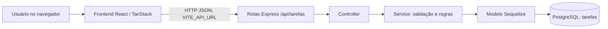

# Documentação técnica e arquitetura

## Sumário

1. [Visão arquitetural](#visão-arquitetural)
2. [Tecnologias e versões](#tecnologias-e-versões)
3. [Organização do repositório](#organização-do-repositório)
4. [Frontend](#frontend)
5. [Backend e comunicação](#backend-e-comunicação)
6. [API REST](#api-rest)
7. [Modelo de dados e regras](#modelo-de-dados-e-regras)
8. [Autenticação e segurança](#autenticação-e-segurança)
9. [Testes e limitações](#testes-e-limitações)

## Visão arquitetural



O frontend e o backend são processos independentes. O cliente HTTP usa `VITE_API_URL` ou, por padrão, `http://localhost:3001/api`. O backend habilita JSON e CORS para uma origem configurada; a persistência é acessada pelo Sequelize.

## Tecnologias e versões

Versões abaixo foram lidas dos manifests. Prefixos `^` representam faixas semânticas, não uma afirmação da versão efetivamente instalada.

| Componente | Versão declarada |
|---|---|
| Node.js runtime | Não especificada |
| Express | `^5.3.0` |
| Sequelize | `^6.37.8` |
| `pg` | `^8.23.1` |
| `cors` | `^2.8.6` |
| `dotenv` | `^18.0.10` |
| React / React DOM | `^19.2.0` |
| TypeScript | `^5.8.3` |
| Vite | `8.1.5` |
| TanStack Start / Router | `^1.168.60` / `1.170.41` |
| Tailwind CSS | `^4.2.1` |
| Vitest | `^4.1.10` |
| Banco de dados | PostgreSQL; versão não declarada |

## Organização do repositório

| Caminho | Responsabilidade |
|---|---|
| `frontend/src/routes/` | Rotas da interface e estrutura de página. |
| `frontend/src/features/tasks/` | Tipos, regras puras, cliente da API, apresentação e testes da funcionalidade de tarefas. |
| `frontend/src/components/ui/` | Componentes visuais reutilizáveis. |
| `frontend/src/lib/` | Utilitários e tratamento de erros do frontend. |
| `backend/index.js` | Inicialização Express, configuração de CORS/JSON, montagem da API e tratamento de erros. |
| `backend/src/config/database.js` | Instância Sequelize e configuração PostgreSQL. |
| `backend/src/model/tarefa.js` | Definição do modelo persistido. |
| `backend/src/router/tarefa.js` | Mapeamento de métodos e caminhos para controllers. |
| `backend/src/controller/tarefa.js` | Tradução das requisições em chamadas de service e respostas HTTP. |
| `backend/src/service/tarefa.js` | Regras de negócio, validação, operações de persistência e adaptação do formato da API. |
| `server.js`, `index.html` | Exemplo HTTP independente com dados fixos; não integra o fluxo principal. |
| `documentos/`, `prompts/` | Documentos e materiais de desenvolvimento existentes. |

## Frontend

A rota principal `/` renderiza `TasksPage`. A página compõe cabeçalho, indicadores, listas de tarefas, cartões, formulário, detalhes e confirmação de exclusão.

O hook `useTasks` realiza requisições HTTP com `fetch`:

- `GET /tarefas` no carregamento e ao tentar novamente.
- `POST /tarefas` ao cadastrar.
- `PUT /tarefas/:id` ao editar.
- `PATCH /tarefas/:id/situacao` ao alternar situação.
- `DELETE /tarefas/:id` ao excluir.

O cliente espera JSON para respostas bem-sucedidas, exceto HTTP 204. Em respostas não exitosas tenta ler `{ "message": "..." }`; caso não haja JSON, usa uma mensagem genérica. A mensagem resultante é apresentada pela interface.

As regras frontend validam que o título não seja vazio após remover espaços. Os campos de título e descrição também têm limites HTML de 120 e 1.000 caracteres. Indicadores de total, pendentes e concluídas são calculados a partir da lista recebida.

`mock-data.ts` contém tarefas fictícias, mas a aplicação atual não o importa no hook de carregamento; é usado pelos testes. No carregamento real, o estado começa vazio até a resposta da API.

## Backend e comunicação

O backend usa ES modules e Express. A API:

1. Carrega dotenv.
2. Configura CORS para `CORS_ORIGIN` ou `http://localhost:5173`.
3. Ativa `express.json()`.
4. Monta o router em `/api/tarefas`.
5. Retorna JSON de recurso não encontrado para outras rotas.
6. Registra erros no console e responde com status e JSON.

Antes de abrir a porta, a inicialização autentica a conexão Sequelize e executa `db.sync({ force: false })`. A porta da API é `PORT` ou `3001`. As variáveis e passos locais constam no [manual de instalação](./03-instalacao-configuracao.md).

### Endpoints

Todos os caminhos abaixo são relativos ao prefixo `/api`; os caminhos completos incluem, por exemplo, `http://localhost:3001/api/tarefas`.

| Método | Caminho | Entrada | Sucesso |
|---|---|---|---|
| `GET` | `/tarefas` | Nenhuma | `200`, array de tarefas ordenado por criação decrescente. |
| `GET` | `/tarefas/:id` | ID inteiro positivo no caminho | `200`, tarefa encontrada. |
| `POST` | `/tarefas` | JSON com `title`; `description` e `dueDate` opcionais | `201`, tarefa criada como pendente. |
| `PUT` | `/tarefas/:id` | ID e JSON com `title`, `description`, `dueDate`, `status` | `200`, tarefa atualizada. |
| `PATCH` | `/tarefas/:id/situacao` | ID; corpo não é usado | `200`, tarefa com situação alternada. |
| `DELETE` | `/tarefas/:id` | ID | `204`, sem corpo. |

Não há paginação, parâmetros de busca, filtro ou ordenação configurável implementados.

### Contratos JSON

Formato de tarefa retornado:

```json
{
  "id": "42",
  "title": "Revisar exercícios",
  "description": "Resolver a lista da aula.",
  "dueDate": "2026-12-05",
  "status": "pendente",
  "createdAt": "2026-11-25T18:00:00.000Z"
}
```

`id` é serializado como string; `dueDate` é string vazia quando não existe data. Datas de criação são serializadas pelo Sequelize/JSON como data e hora. Exemplo de cadastro:

```http
POST /api/tarefas
Content-Type: application/json
```

```json
{
  "title": "Revisar exercícios",
  "description": "Resolver a lista da aula.",
  "dueDate": "2026-12-05"
}
```

O servidor define a situação inicial como `pendente`, independentemente de um status enviado no cadastro. Exemplo de atualização:

```json
{
  "title": "Revisar exercícios",
  "description": "Resolver a lista da aula.",
  "dueDate": "2026-12-05",
  "status": "concluida"
}
```

Listagem:

```json
[
  {
    "id": "42",
    "title": "Revisar exercícios",
    "description": "Resolver a lista da aula.",
    "dueDate": "2026-12-05",
    "status": "pendente",
    "createdAt": "2026-11-25T18:00:00.000Z"
  }
]
```

Exemplo de erro de validação:

```json
{ "message": "Informe o título da tarefa" }
```

### Status e tratamento de erros

| Status | Condição observada | Formato |
|---|---|---|
| `201` | Cadastro concluído | JSON da tarefa. |
| `204` | Exclusão concluída | Sem corpo. |
| `400` | ID inválido ou validação explícita de entrada | `{ "message": "..." }`. |
| `404` | Tarefa inexistente ou rota não encontrada | Mensagem JSON; rota sem recurso usa “Recurso não encontrado”. |
| `500` | Erro não classificado como 4xx | `{ "message": "Erro interno do servidor" }`. |

As mensagens de validação do service incluem título ausente, título acima de 120 caracteres, descrição acima de 1.000 caracteres, formato de data não reconhecido e situação inválida. A validação da data no service verifica o formato `AAAA-MM-DD`; não há validação explícita adicional de calendário nessa função.

O middleware também imprime o objeto de erro no console do backend. Erros de validação específicos do ORM não têm mapeamento dedicado no código e podem ser tratados como erro interno.

## Modelo de dados e regras

Há uma entidade persistida, `tarefas`, sem relacionamentos declarados:

| Campo da API | Coluna do modelo | Tipo Sequelize | Regra identificada |
|---|---|---|---|
| `id` | `id` | `INTEGER` | Chave primária, auto incremento. |
| `title` | `titulo` | `STRING(120)` | Obrigatório; não vazio; máximo de 120 caracteres validado no service. |
| `description` | `descricao` | `STRING(1000)` | Não nulo; padrão vazio; máximo de 1.000 caracteres validado no service. |
| `dueDate` | `dataVencimento` | `DATEONLY` | Permite nulo; API usa string vazia quando ausente. |
| `status` | `situacao` | `ENUM` | Valores `pendente` e `concluida`; padrão pendente. |
| `createdAt` | `criadoEm` | Timestamp Sequelize | Criado pelo ORM; ordena a listagem do mais recente ao mais antigo. |

Não foram encontradas associações entre entidades, índices adicionais, migrations ou seeds. O modelo usa o nome de tabela `tarefas`; veja [Banco de dados](./05-banco-de-dados.md).

## Autenticação e segurança

- Não há autenticação ou autorização de usuário na API.
- O middleware CORS limita a origem do navegador conforme uma variável, mas não autentica clientes nem restringe chamadas não-browser.
- O backend aceita JSON; não foram encontrados limites de taxa, auditoria, política de retenção ou filtragem por proprietário.
- As credenciais do PostgreSQL devem ser fornecidas por ambiente e não registradas na documentação. Arquivos `.env` são ignorados pelo Git.
- O exemplo de configuração SSL está desativado por padrão; requisitos de TLS para implantação devem ser confirmados.

Esses fatos descrevem a implementação encontrada e não constituem avaliação ou certificação de segurança para produção.

## Testes e limitações

Os testes existentes são testes frontend de regras de tarefas e correspondência da rota `/`. Não foram encontrados testes automatizados para controllers, services, banco, API ou integração ponta a ponta.

Verificações executadas durante a documentação: `npm test` passou com 7 testes; `npm run build` passou. `npm run lint` falhou com 5.850 erros e 8 avisos do Prettier, reportando remoção de `CR` em fim de linha. Nenhum código foi alterado para tratar o resultado.

Outras limitações confirmadas:

- Sem autenticação, autorização, usuários ou papéis.
- Sem filtros, pesquisa, paginação, exportação ou notificações.
- Sem migrations, seed, backup ou restauração automatizados.
- A etiqueta “Dados de demonstração” da interface não corresponde ao carregamento real via API.
- O exemplo `server.js` usa formato e fonte de dados distintos e não é a API consumida pelo frontend principal.
- Implantação de produção e compatibilidade de versões precisam ser confirmadas.
