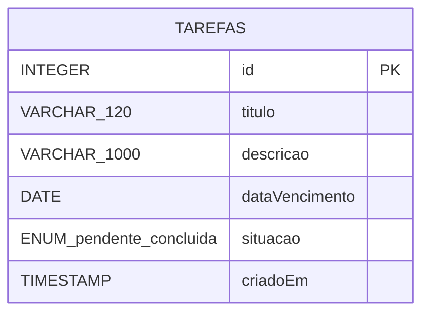

# Banco de dados

## Sumário

1. [SGBD e conexão](#sgbd-e-conexão)
2. [Entidade `tarefas`](#entidade-tarefas)
3. [Diagrama entidade-relacionamento](#diagrama-entidade-relacionamento)
4. [Restrições e índices](#restrições-e-índices)
5. [Inicialização e sincronização](#inicialização-e-sincronização)
6. [Migração, backup e pendências](#migração-backup-e-pendências)

## SGBD e conexão

O backend configura o Sequelize para o dialeto **PostgreSQL** e usa o driver `pg`. Os parâmetros de conexão são lidos de variáveis de ambiente em `backend/src/config/database.js`. O arquivo `backend/.env.example` fornece nomes e valores de referência; não inclua senhas reais em documentação, repositório ou chamados de suporte.

As variáveis documentadas estão em [Instalação e configuração](./03-instalacao-configuracao.md). O projeto não inclui um script que crie o banco PostgreSQL; o banco indicado por `DB_NAME` deve existir antes de iniciar a API.

## Entidade `tarefas`

O modelo Sequelize define explicitamente a tabela `tarefas`.

| Coluna | Tipo Sequelize | Null? / padrão | Chave e descrição |
|---|---|---|---|
| `id` | `INTEGER` | Não nulo por ser chave primária; auto incremento | Chave primária. Identificador da tarefa. |
| `titulo` | `STRING(120)` | `allowNull: false` | Título. O service rejeita vazio e mais de 120 caracteres. |
| `descricao` | `STRING(1000)` | `allowNull: false`; padrão `""` | Texto descritivo, opcional na interface; ausente é convertido para string vazia. |
| `dataVencimento` | `DATEONLY` | `allowNull: true` | Data sem horário. A API converte valor ausente em `null` e a resposta em string vazia. |
| `situacao` | `ENUM("pendente", "concluida")` | `allowNull: false`; padrão `"pendente"` | Estado da tarefa. |
| `criadoEm` | Timestamp do Sequelize | Gerenciado pelo Sequelize | Data de criação; corresponde a `createdAt` na API. Atualização automática desabilitada (`updatedAt: false`). |

O modelo desativa o campo automático de atualização (`updatedAt: false`). Não foi definido campo de usuário, proprietário ou chave estrangeira.

## Diagrama entidade-relacionamento

O sistema tem somente essa entidade no código analisado. Não há relacionamentos a representar.

## Restrições e índices

- `id` é chave primária e auto incremental.
- `titulo` e `situacao` não permitem nulo segundo a definição do modelo; o título tem validação de não vazio e limite de 120 caracteres no service.
- `descricao` não permite nulo e tem padrão vazio, com limite de 1.000 caracteres validado pelo service.
- `dataVencimento` permite nulo.
- `situacao` aceita somente `pendente` ou `concluida` no modelo; o service também valida a situação recebida durante atualização.
- Não há índices secundários, índices únicos ou chaves estrangeiras explicitamente definidos no código. O mecanismo de banco pode criar estruturas associadas à chave primária.

O formato de data é validado no service com uma expressão para `AAAA-MM-DD`. A expressão não garante, por si só, que a data corresponda a um dia válido do calendário.

## Inicialização e sincronização

1. Provisione um PostgreSQL e crie o banco indicado por `DB_NAME`.
2. Configure as variáveis de conexão no arquivo local `backend/.env`.
3. Inicie o backend com `npm run dev:backend` na raiz.
4. O código executa `authenticate()` e, em seguida, `db.sync({ force: false })`.
5. Após a conexão e sincronização, a API começa a escutar na porta `PORT` ou `3001`.

O sincronismo automático pode criar a tabela do modelo quando ela ainda não existe. Não há script versionado de criação manual de tabela nem controle de versão do schema. `force: false` não solicita a remoção e recriação forçada da tabela; ainda assim, esse mecanismo não substitui um processo formal de migration.

## Migração, backup e pendências

Não foram encontrados migrations, seeds, tarefas automatizadas de backup ou procedimentos de restauração no repositório. Portanto, não é possível documentar esses recursos como implementados.

Antes de produção, a equipe responsável deve definir e testar:

- Estratégia de migrations e evolução compatível do schema.
- Frequência, retenção, criptografia e local de armazenamento de backups.
- Procedimento de restauração e verificação de integridade.
- Usuário PostgreSQL com privilégios mínimos necessários.
- Política de conexão TLS/SSL e rotação de credenciais.
- Versão PostgreSQL suportada e monitoramento da disponibilidade.

Consulte [Manutenção e suporte](./06-manutencao-suporte.md) para as recomendações operacionais não implementadas.
